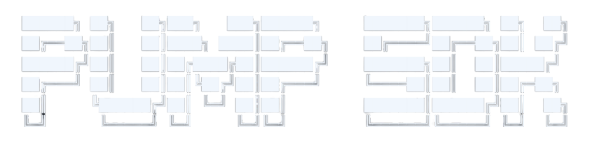

# Fee Sharing Guide

> Set up and manage creator fee distribution among up to 10 shareholders, from config creation through distribution and authority management.

<div align="center">
  
</div>

## Overview

Fee sharing allows token creators to split their accumulated trading fees among up to 10 shareholders. This is managed through the **PumpFees** program and works for both bonding curve tokens and graduated AMM tokens.

## Prerequisites

```typescript
import { Connection, PublicKey, Transaction, Keypair } from "@solana/web3.js";
import {
  PUMP_SDK,
  OnlinePumpSdk,
  isCreatorUsingSharingConfig,
  feeSharingConfigPda,
} from "@nirholas/pump-sdk";

const connection = new Connection(
  process.env.PUMP_RPC_URL ?? "https://api.mainnet-beta.solana.com",
  "confirmed",
);
const onlineSdk = new OnlinePumpSdk(connection);
```

## Step 1: Create a Fee Sharing Config

After creating a token, set up fee sharing:

```typescript
const mint = new PublicKey("your-token-mint");
const creator = wallet.publicKey;

// For non-graduated tokens (still on bonding curve):
const ix = await PUMP_SDK.createFeeSharingConfig({
  creator,
  mint,
  pool: null,
});

// For graduated tokens (on AMM), you must provide the pool:
import { canonicalPumpPoolPda } from "@nirholas/pump-sdk";
const pool = canonicalPumpPoolPda(mint);

const ix = await PUMP_SDK.createFeeSharingConfig({
  creator,
  mint,
  pool,
});
```

> **Note:** For graduated tokens (`bondingCurve.complete === true`), you must provide the pool address. For ungraduated tokens, pass `pool: null`.

## Step 2: Set Up Shareholders

Define how fees are split. Shares are in basis points (bps), where 10,000 bps = 100%.

```typescript
const shareholders = [
  { address: new PublicKey("wallet-A"), shareBps: 5000 }, // 50%
  { address: new PublicKey("wallet-B"), shareBps: 3000 }, // 30%
  { address: new PublicKey("wallet-C"), shareBps: 2000 }, // 20%
];

const ix = await PUMP_SDK.updateFeeShares({
  authority: creator,          // The config admin
  mint,
  currentShareholders: [],     // Empty on first setup
  newShareholders: shareholders,
});
```

### Validation Rules

The SDK validates shareholders before building the instruction:

| Rule | Error |
|------|-------|
| At least 1 shareholder | `NoShareholdersError` |
| Maximum 10 shareholders | `TooManyShareholdersError` |
| No zero shares | `ZeroShareError` |
| Shares sum to 10,000 bps | `InvalidShareTotalError` |
| No duplicate addresses | `DuplicateShareholderError` |

## Step 3: Check Distributable Fees

Before distributing, check if there are enough accumulated fees:

```typescript
const result = await onlineSdk.getMinimumDistributableFee(mint);

console.log("Minimum required:", result.minimumRequired.toString());
console.log("Available:", result.distributableFees.toString());
console.log("Can distribute:", result.canDistribute);
console.log("Token graduated:", result.isGraduated);
```

## Step 4: Distribute Fees

When fees are ready, build and send the distribution transaction:

```typescript
const { instructions, isGraduated } =
  await onlineSdk.buildDistributeCreatorFeesInstructions(mint, wallet.publicKey);

const tx = new Transaction().add(...instructions);
const sig = await sendAndConfirmTransaction(connection, tx, [wallet]);
```

For graduated tokens, the method automatically includes a `transferCreatorFeesToPump` instruction to consolidate AMM vault fees before distributing.

### Sweeping creator fees first

Since the October 2026 upgrade, `buy_v3` / `sell_v3` on the curve and PumpSwap `buy_v2` / `sell_v2` keep the creator fee in the curve (`BondingCurve.creatorFee`) or pool (`Pool.creatorFees`) instead of paying it into the creator vault on every trade. A permissionless `sweep_creator_fee` moves it into the vault, and the distribution refuses to run while some is still waiting (pump 6095 `CreatorFeesNotSwept`).

Pass a `payer` to `buildDistributeCreatorFeesInstructions` and it puts the sweeps the coin needs in front of the distribution. Without a `payer` it throws when the curve holds un-swept creator fees, rather than return a transaction that would fail on chain. The payer only covers small rent costs (a missing quote ATA, or growing a pre-upgrade curve). To build the sweeps yourself:

```typescript
// [] when neither the curve nor the canonical pool holds a creator fee
const sweeps = await onlineSdk.creatorFeeSweepInstructions(mint, wallet.publicKey);

// Or one by one with the offline SDK
const curveSweep = await PUMP_SDK.sweepCreatorFeeInstruction({
  payer: wallet.publicKey,
  mint,
  creator: bondingCurve.creator,          // the sharing config PDA once migrated to sharing
  quoteMint: bondingCurve.quoteMint,
});
const poolSweep = await PUMP_SDK.ammSweepCreatorFeeInstruction({
  payer: wallet.publicKey,
  mint,
  coinCreator: pool.coinCreator,
});
```

The same rule applies to `createFeeSharingConfig` and `updateFeeShares` (pump-fees 6033 `PoolCreatorFeesNotSwept` on a graduated coin): sweep first, in the same transaction.

## Checking Fee Sharing Status

When a creator migrates to fee sharing, the creator address stored on-chain (in `BondingCurve.creator` or, after graduation, `Pool.coinCreator`) is replaced with the fee sharing config PDA. `isCreatorUsingSharingConfig` checks exactly that, so pass the on-chain creator field, not the human creator's wallet:

```typescript
// Ungraduated token
const bondingCurve = await onlineSdk.fetchBondingCurve(mint);
const isSharing = isCreatorUsingSharingConfig({ mint, creator: bondingCurve.creator });

// Graduated token
const pool = await onlineSdk.fetchPool(mint);
const isSharingAmm = isCreatorUsingSharingConfig({ mint, creator: pool.coinCreator });

if (isSharing) {
  const config = await onlineSdk.fetchSharingConfig(mint);
  console.log(config.shareholders);
}
```

To check whether a config can still be edited, use `isSharingConfigEditable({ sharingConfig })`: legacy v1 configs and revoked v2 configs are immutable.

## Updating Shareholders

To change the distribution, pass both current and new shareholders:

```typescript
const currentShareholders = [
  new PublicKey("wallet-A"),
  new PublicKey("wallet-B"),
  new PublicKey("wallet-C"),
];

const newShareholders = [
  { address: new PublicKey("wallet-A"), shareBps: 6000 },
  { address: new PublicKey("wallet-D"), shareBps: 4000 },
];

const ix = await PUMP_SDK.updateFeeShares({
  authority: creator,
  mint,
  currentShareholders,  // PublicKey[] of current shareholders
  newShareholders,
});
```

## Collecting Creator Fees (Without Sharing)

If fee sharing is not set up, creators can collect fees directly. Fees that v3 curve trades or PumpSwap v2 trades left behind reach the vault only after a sweep, so put `onlineSdk.creatorFeeSweepInstructions(mint, payer)` for each of the creator's coins in front of the collect to include them:

```typescript
// Collect from both Pump and AMM programs
const instructions = await onlineSdk.collectCoinCreatorFeeInstructions(creator);

// Check balance before collecting
const balance = await onlineSdk.getCreatorVaultBalanceBothPrograms(creator);
console.log("Uncollected fees:", balance.toString(), "lamports");
```

## Social Fee PDAs

For platform-based fee routing (paying a shareholder by platform identity rather than wallet address), the SDK supports social fee PDAs. Only GitHub is currently supported (`SUPPORTED_SOCIAL_PLATFORMS`), and the `userId` is the numeric GitHub user id (from `https://api.github.com/users/<username>`) as a string.

```typescript
import { Platform } from "@nirholas/pump-sdk";

// Create a social fee PDA for a platform user
const ix = await PUMP_SDK.createSocialFeePdaInstruction({
  payer: wallet.publicKey,
  userId: "583231",
  platform: Platform.GitHub,
});

// Claim fees routed to a social fee PDA (signed by the social claim authority)
const ix2 = await PUMP_SDK.claimSocialFeePdaInstruction({
  recipient: wallet.publicKey,
  socialClaimAuthority: authorityKeypair.publicKey,
  userId: "583231",
  platform: Platform.GitHub,
});
```

To mix wallet and social shareholders in one config, use the wrappers that resolve identities and create any missing PDAs for you:

```typescript
const ixs = await PUMP_SDK.updateSharingConfigWithSocialRecipients({
  authority: creator,
  mint,
  currentShareholders: [],
  newShareholders: [
    { address: wallet.publicKey, shareBps: 7000 },
    { userId: "583231", platform: Platform.GitHub, shareBps: 3000 },
  ],
});
```

## Authority Management

The fee sharing config has an admin who can update shareholders. The SDK provides methods to transfer, reset, or permanently revoke this authority.

### Transfer Authority

Transfer admin control to a new address:

```typescript
const ix = await PUMP_SDK.transferFeeSharingAuthorityInstruction({
  authority: wallet.publicKey,  // current admin
  mint,
  newAdmin: newAdminPublicKey,
});
```


### Revoke Authority (Irreversible)

Permanently lock the fee sharing configuration. After this, no one can modify shareholders.

```typescript
const ix = await PUMP_SDK.revokeFeeSharingAuthorityInstruction({
  authority: wallet.publicKey,
  mint,
});
```

> **Warning:** Revoking is permanent. The `adminRevoked` flag in `SharingConfig` will be set to `true` and no further changes are possible.

## Runnable examples

Accounts & Events examples 21-30 include fetching and decoding sharing configs; run `npm run example NN` to try them.

## Related

- [Fee Tiers](./fee-tiers.md): how the creator fee rate itself is determined
- [Error Reference](./errors.md): the shareholder validation errors
- [Social Fees](./social-fees.md): platform-identity fee routing in depth


